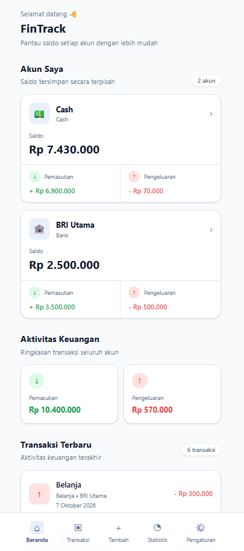
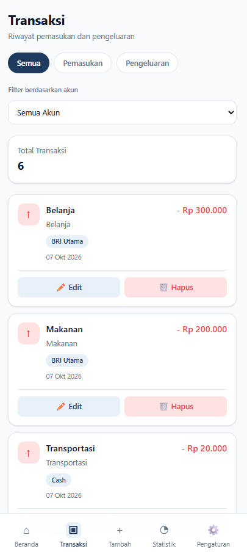
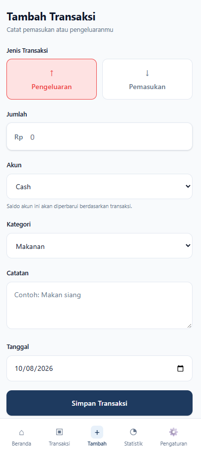
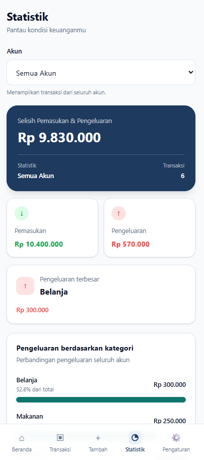
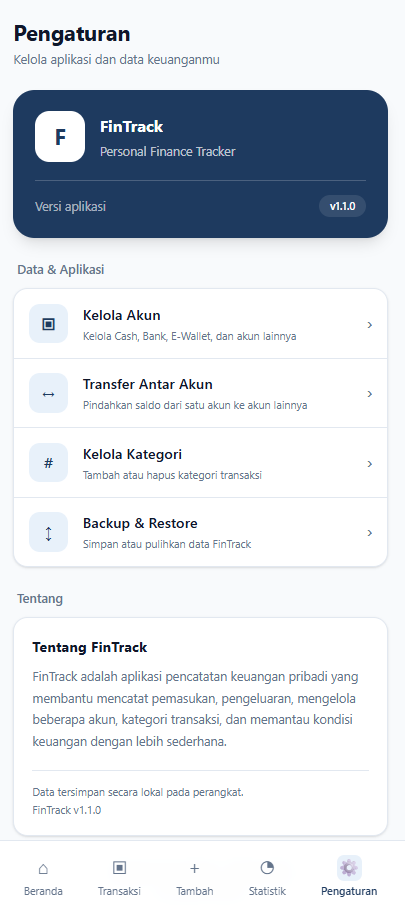

# FinTrack 💰

**FinTrack** adalah aplikasi pencatatan keuangan pribadi berbasis Android yang membantu pengguna mengelola pemasukan, pengeluaran, dan saldo dari beberapa akun secara terpisah. Aplikasi dapat digunakan secara offline dan dibuat sebagai proyek portfolio pengembangan aplikasi.

## 📱 Tampilan Aplikasi

| Dashboard | Transaksi | Tambah Transaksi |
|:---:|:---:|:---:|
|  |  |  |

| Statistik | Pengaturan |
|:---:|:---:|
|  |  |

## ✨ Fitur Utama

- **Multi-account:** kelola Cash, Bank, E-Wallet, dan jenis akun lainnya secara terpisah.
- **Saldo otomatis per akun:** dihitung dari saldo awal, pemasukan, pengeluaran, serta transfer masuk/keluar.
- **Transaksi:** tambah, edit, pindah akun, hapus, dan filter berdasarkan jenis maupun akun.
- **Transfer antar-akun:** pindahkan saldo tanpa mencatat transfer sebagai pemasukan atau pengeluaran.
- **Detail akun:** lihat saldo dan riwayat aktivitas setiap akun.
- **Statistik keuangan:** ringkasan pemasukan, pengeluaran, dan pengeluaran per kategori, dengan filter akun.
- **Pengelolaan akun dan kategori:** tambah, edit akun, dan kelola kategori transaksi.
- **Backup & Restore:** ekspor dan impor data dalam format JSON.
- **Offline-first:** data disimpan secara lokal di perangkat.

## 🛠️ Teknologi

| Teknologi | Kegunaan |
|---|---|
| React | Antarmuka aplikasi |
| Vite | Development server dan build web |
| Tailwind CSS | Styling responsif |
| Capacitor | Mengemas aplikasi web menjadi Android |
| Android Studio | Build dan pengujian APK Android |
| localStorage | Penyimpanan data lokal |

## 🚀 Menjalankan di Komputer

Prasyarat: **Node.js** dan **npm** sudah terpasang.

```bash
npm install
npm run dev
```

Buka alamat lokal yang ditampilkan Vite pada terminal (biasanya `http://localhost:5173`).

## 🤖 Build Android

Prasyarat: **Android Studio**, **Android SDK**, dan environment Android untuk Capacitor telah dikonfigurasi.

```bash
npm run build
npx cap sync android
npx cap open android
```

Kemudian build atau jalankan aplikasi melalui Android Studio. Untuk menghasilkan APK rilis yang dapat dibagikan, gunakan proses **Generate Signed App Bundle or APK** dan signing key milik pengembang.

## 📦 APK

**Versi portfolio: v1.1.0**

File APK rilis dapat didistribusikan melalui tab **Releases** pada repository ini setelah diunggah oleh pengembang.

> Catatan: APK release perlu ditandatangani dengan keystore yang aman. **Jangan upload keystore (`.jks`), password, atau file konfigurasi berisi rahasia ke GitHub.**

## 💾 Penyimpanan & Privasi

FinTrack menggunakan **localStorage** untuk menyimpan data di perangkat. Saat ini tidak ada sinkronisasi cloud atau sistem akun pengguna. Data dapat hilang jika penyimpanan aplikasi dibersihkan atau aplikasi dihapus; lakukan **Backup** berkala sebelum pindah perangkat atau menghapus aplikasi.

## 📝 Status Proyek

**FinTrack v1.1.0** — versi portfolio dengan dukungan multi-account dan build Android.

Dikembangkan sebagai proyek portfolio personal untuk mempraktikkan React, pengelolaan state, penyimpanan offline, serta integrasi aplikasi web dengan Android menggunakan Capacitor.
